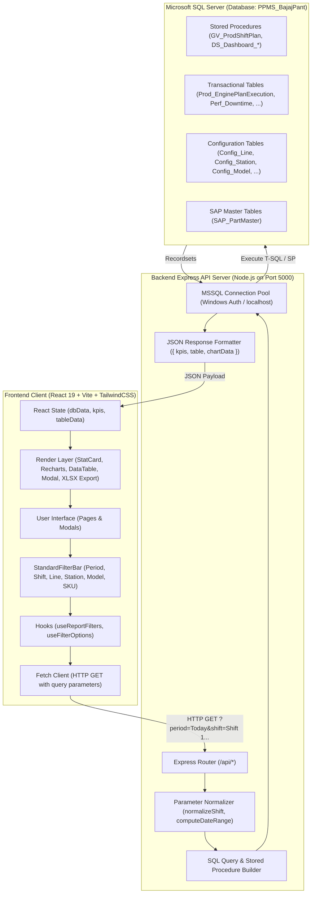
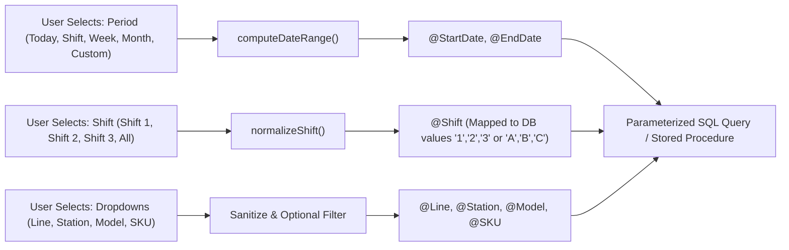
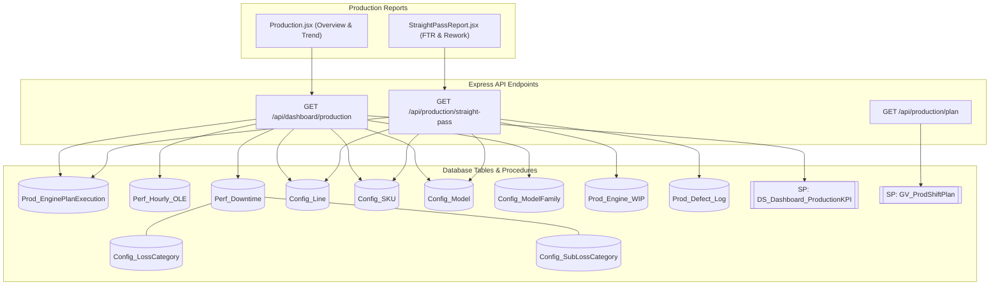
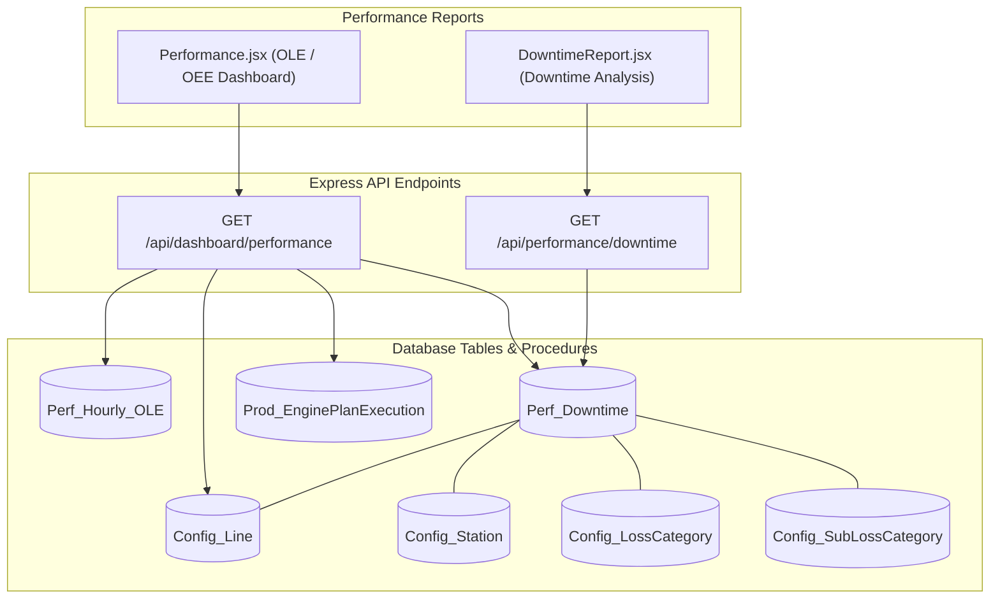
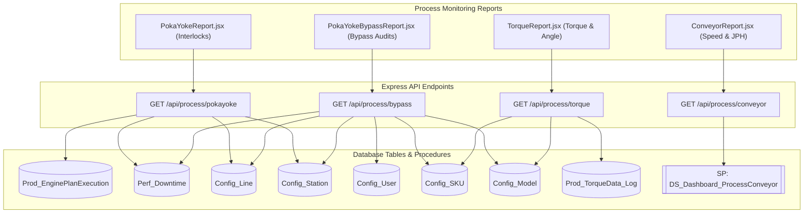
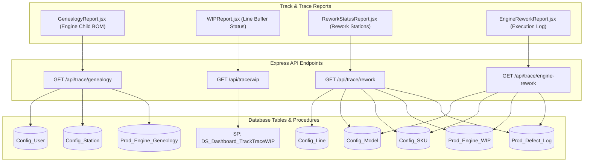
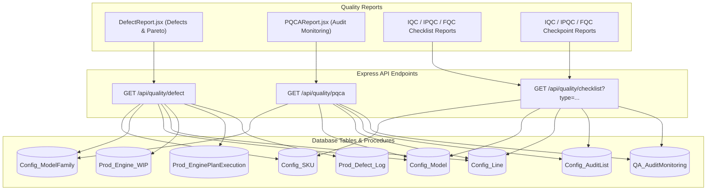
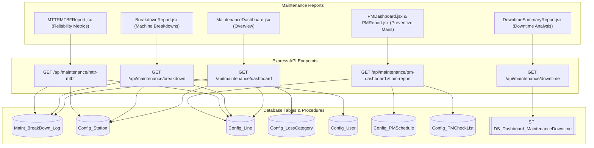
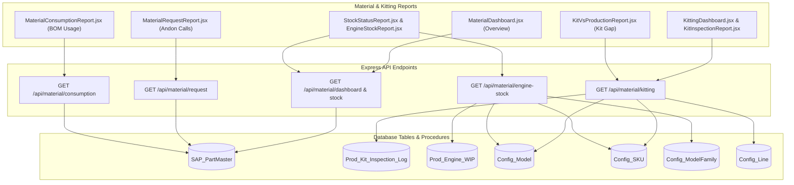
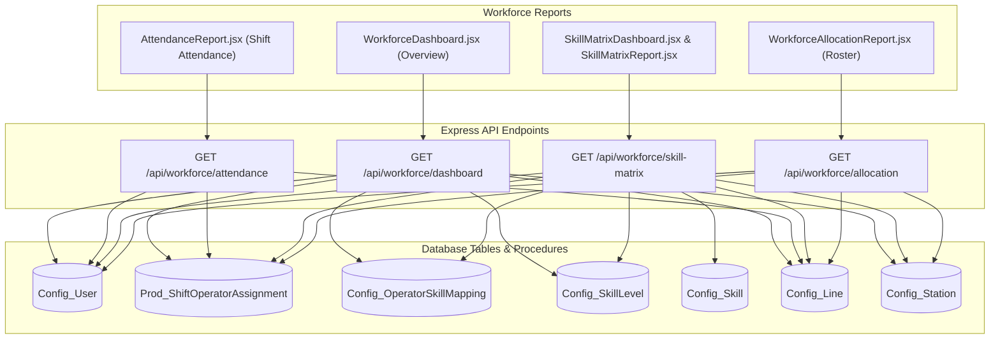

# Complete End-to-End Data Lineage & Database Table Mapping

This document provides a comprehensive architectural flow chart and data dictionary for every report, dashboard, and modal across all 8 modules of the **Bajaj MES Dashboard** system.

---

## 1. High-Level System Architecture Data Flow

The diagram below illustrates the end-to-end data pipeline from user interaction on the shop floor to the SQL Server database (`PPMS_BajajPant`) and back:

---

## 2. Global Filter & Parameter Normalization Flow

Before any SQL query runs, user filter inputs pass through standard normalization logic:

---

## 3. Module-by-Module Data Flow & Table Mappings

---

### Module 1: Production Module

#### 1.1 Architectural Flow Chart

#### 1.2 Data Dictionary & Table Cross-Reference

| Report / Component | API Endpoint | Database Tables / Procedures | Joined Columns | Extracted Fields & Metrics | UI Destination |
| :--- | :--- | :--- | :--- | :--- | :--- |
| **Production Report** (`Production.jsx`) | `/api/dashboard/production` | `DS_Dashboard_ProductionKPI` (SP) `Prod_EnginePlanExecution` `Perf_Hourly_OLE` `Config_Line` `Config_SKU` `Config_Model` `Config_ModelFamily` | `E.LineID = L.LineID` `E.SKUID = S.SKUID` `S.ModelID = M.ModelID` `M.ModelFamilyID = F.ModelFamilyID` | `PlanQty`, `ENGCompleted_Qty`, `ENGReworkOK_Qty`, `ENGMainLine_Qty`, `ENGMaterialHold_Qty`, `ENGQualityHold_Qty`, Hourly `PlannedQuantity`, `GoodQuantity` | `StatCard` (Plan, Actual, Shortfall, WIP, Rollover), Plan vs Actual Trend Chart, SKU Data Table |
| **Straight Pass Report** (`StraightPassReport.jsx`) | `/api/production/straight-pass` | `Prod_EnginePlanExecution` `Prod_Engine_WIP` `Prod_Defect_Log` `Config_Line` `Config_SKU` `Config_Model` | `E.LineID = L.LineID` `E.SKUID = S.SKUID` `S.ModelID = M.ModelID` `E.EngineNo = W.EngineNo` | Total Inspected, Straight Pass Qty, Rework Pass Qty, Rejected Qty, First-Time-Right (FTR) Yield %, Defect Descriptions | FTR % Gauge Card, Reworked Trend, Straight Pass vs Defect Breakdown Table |
| **Production Shift Plan** | `/api/production/plan` | `GV_ProdShiftPlan` (Official SP) | Param: `@ProdDate`, `@ProdShift` | Scheduled Model Codes, Planned Line Allocations, Shift Target Counts | Master Shift Production Schedule Table |

---

### Module 2: Performance Module (OEE / OLE & Downtime)

#### 2.1 Architectural Flow Chart

#### 2.2 Data Dictionary & Table Cross-Reference

| Report / Component | API Endpoint | Database Tables / Procedures | Joined Columns | Extracted Fields & Metrics | UI Destination |
| :--- | :--- | :--- | :--- | :--- | :--- |
| **Performance (OLE/OEE) Dashboard** (`Performance.jsx`) | `/api/dashboard/performance` | `Perf_Hourly_OLE` `Perf_Downtime` `Prod_EnginePlanExecution` `Config_Line` | `H.SubAsslyLineID = L.LineID` `D.SubAsslyLineID = L.LineID` | `OLE_Percentage`, `Availability_Percentage`, `Performance_Percentage`, `Quality_Percentage`, `TotalDT`, Operating Time | OLE/OEE Radial Gauges, Availability/Performance/Quality KPI Cards, Hourly OLE Trend Chart |
| **Downtime Report** (`DowntimeReport.jsx`) | `/api/performance/downtime` | `Perf_Downtime` `Config_Line` `Config_Station` `Config_LossCategory` `Config_SubLossCategory` | `D.SubAsslyLineID = L.LineID` `D.StationID = S.StationID` `D.LossID = LC.LossID` `D.SubLossID = SLC.SubLossID` | `StartTime`, `EndTime`, `TotalDT` (Minutes), `Reason`, `LossName`, `SubLossName`, `StationName`, `LineName` | Total Downtime Duration, Stoppage Incidents, Top Loss Pareto Chart, Downtime Log Grid |

---

### Module 3: Process Monitoring Module

#### 3.1 Architectural Flow Chart

#### 3.2 Data Dictionary & Table Cross-Reference

| Report / Component | API Endpoint | Database Tables / Procedures | Joined Columns | Extracted Fields & Metrics | UI Destination |
| :--- | :--- | :--- | :--- | :--- | :--- |
| **Poka Yoke Report** (`PokaYokeReport.jsx`) | `/api/process/pokayoke` | `Prod_EnginePlanExecution` `Perf_Downtime` `Config_Line` `Config_Station` | `D.SubAsslyLineID = L.LineID` `D.StationID = S.StationID` | Total Interlock Checks, Active Interlocks, Failed Checks, Station-wise Poka Yoke Status | Interlock OK/NOK Counter, Station Compliance Bar Chart, Real-time Sensor Interlock Grid |
| **Poka Yoke Bypass Report** (`PokaYokeBypassReport.jsx`) | `/api/process/bypass` | `Perf_Downtime` `Config_Line` `Config_Station` `Config_User` `Config_SKU` | `D.SubAsslyLineID = L.LineID` `D.StationID = S.StationID` `D.UserID = U.UserID` | Bypass Timestamp, Station ID, Reason / Authorization, Approver Name (`Config_User`), Duration | Total Bypass Events, Active Bypasses, High-risk Station Table, Authorized Bypass Log |
| **Torque Report** (`TorqueReport.jsx`) | `/api/process/torque` | `Prod_TorqueData_Log` `Config_SKU` `Config_Model` | `T.SKUID = S.SKUID` `S.ModelID = M.ModelID` | `SpindleNo`, `TargetTorque`, `ActualTorque`, `TargetAngle`, `ActualAngle`, `TorqueStatus` (OK/NOK), `AngleStatus` | Fastening Pass Rate %, Torque Distribution Curve, Tightening Angle vs Torque Scatter, Bolt-level Log |
| **Conveyor Report** (`ConveyorReport.jsx`) | `/api/process/conveyor` | `DS_Dashboard_ProcessConveyor` (SP) | Param: `@LineID`, `@ProdDate` | Conveyor Belt Speed (m/min), Drive Motor Current, JPH (Jobs Per Hour), Pitch Time, VFD Frequency | Line Speed Gauge, JPH Actual vs Target Trend, Motor Load Graph, Carrier Tracking Grid |

---

### Module 4: Track & Trace Module

#### 4.1 Architectural Flow Chart

#### 4.2 Data Dictionary & Table Cross-Reference

| Report / Component | API Endpoint | Database Tables / Procedures | Joined Columns | Extracted Fields & Metrics | UI Destination |
| :--- | :--- | :--- | :--- | :--- | :--- |
| **Genealogy Report** (`GenealogyReport.jsx`) | `/api/trace/genealogy` | `Prod_Engine_Geneology` `Config_Station` `Config_User` | `G.StationID = S.StationID` `G.UserID = U.UserID` | `EngineNo`, `PartBarcode`, `PartName`, `StationName`, `ScanTimestamp`, `OperatorName`, Batch Code | 2D Barcode Search Bar, Engine BOM Hierarchy Tree, Child Part Traceability Grid |
| **WIP Report** (`WIPReport.jsx`) | `/api/trace/wip` | `DS_Dashboard_TrackTraceWIP` (SP) | Param: `@LineID`, `@ProdDate` | `StationID`, `StationName`, `EngineCount`, `BottleneckFlag`, Buffer Utilization %, Min/Max Dwell Time | Line Balance Flow Chart, Station WIP Heatmap, Bottleneck Warning Banner, Station WIP Table |
| **Rework Status Report** (`ReworkStatusReport.jsx`) | `/api/trace/rework` | `Prod_Defect_Log` `Prod_Engine_WIP` `Config_SKU` `Config_Model` `Config_Line` | `D.EngineNo = W.EngineNo` `W.SKUID = S.SKUID` `S.ModelID = M.ModelID` `W.LineID = L.LineID` | `EngineNo`, `DefectCode`, `DefectDescription`, `Status` (Under Rework, Cleared, Scrapped), `ReworkStationID` | Rework Queue Counter, Defect Disposition Pie Chart, Active Rework Engine Grid |
| **Engine Rework Log** (`EngineReworkReport.jsx`) | `/api/trace/engine-rework` | `Prod_Defect_Log` `Prod_Engine_WIP` `Config_SKU` `Config_Model` | `D.EngineNo = W.EngineNo` `W.SKUID = S.SKUID` `S.ModelID = M.ModelID` | `ReworkStartTime`, `ReworkEndTime`, `ReworkActionTaken`, `PartsReplaced`, `ReworkInspector` | Rework Cycle Time KPI, Defect-to-Action Matrix, Detailed Engine Rework Ledger |

---

### Module 5: Quality Module

#### 5.1 Architectural Flow Chart

#### 5.2 Data Dictionary & Table Cross-Reference

| Report / Component | API Endpoint | Database Tables / Procedures | Joined Columns | Extracted Fields & Metrics | UI Destination |
| :--- | :--- | :--- | :--- | :--- | :--- |
| **Defect Report** (`DefectReport.jsx`) | `/api/quality/defect` | `Prod_Defect_Log` `Prod_EnginePlanExecution` `Prod_Engine_WIP` `Config_Line` `Config_SKU` `Config_Model` | `D.EngineNo = W.EngineNo` `W.SKUID = S.SKUID` `S.ModelID = M.ModelID` `W.LineID = L.LineID` | `DefectName`, `DefectCategory`, `TotalDefects`, `EngineNo`, `StationID`, DPMO (Defects Per Million Opportunities) | Total Defect Count, DPMO Metric Card, Defect Category Pareto Chart, Defect Log Table |
| **PQCA Report** (`PQCAReport.jsx`) | `/api/quality/pqca` | `QA_AuditMonitoring` `Config_AuditList` `Config_Line` `Config_Model` `Config_ModelFamily` | `A.AuditID = AL.AuditID` `A.LineID = L.LineID` `A.ModelID = M.ModelID` `M.ModelFamilyID = F.ModelFamilyID` | `AuditDate`, `Shift`, `AuditorName`, `TotalCheckpoints`, `PassedCheckpoints`, `FailedCheckpoints`, `ComplianceRate` | PQCA Compliance % Gauge, Audit Pass Rate Trend, Non-Conformance Issue Matrix |
| **IQC / IPQC / FQC Checklists** (`*ChecklistReport.jsx`) | `/api/quality/checklist?type=IQC\|IPQC\|FQC` | `QA_AuditMonitoring` `Config_AuditList` `Config_Line` `Config_Model` `Config_SKU` | `A.AuditID = AL.AuditID` `A.LineID = L.LineID` `A.ModelID = M.ModelID` `A.SKUID = S.SKUID` | `ChecklistName`, `Frequency`, `AuditStage` (IQC/IPQC/FQC), `Status` (Approved/Pending), `AuditRemarks` | Checklist Completion Rate, Stage Compliance KPI, Master Audit Checklist Table |
| **IQC / IPQC / FQC Checkpoints** (`*CheckpointReport.jsx`) | `/api/quality/checklist?type=IQC\|IPQC\|FQC` | `QA_AuditMonitoring` `Config_AuditList` `Config_Line` `Config_Model` `Config_SKU` | `A.AuditID = AL.AuditID` `A.LineID = L.LineID` `A.ModelID = M.ModelID` | `CheckpointDescription`, `SpecificationLimit`, `ObservedValue`, `Result` (Pass/Fail), `InstrumentUsed` | Parameter Tolerances, Checkpoint Pass Rate %, Out-of-Spec Alert Table |

---

### Module 6: Maintenance Module

#### 6.1 Architectural Flow Chart

#### 6.2 Data Dictionary & Table Cross-Reference

| Report / Component | API Endpoint | Database Tables / Procedures | Joined Columns | Extracted Fields & Metrics | UI Destination |
| :--- | :--- | :--- | :--- | :--- | :--- |
| **Maintenance Dashboard** (`MaintenanceDashboard.jsx`) | `/api/maintenance/dashboard` | `Maint_BreakDown_Log` `Config_Station` `Config_Line` `Config_LossCategory` | `B.StationID = S.StationID` `B.LineID = L.LineID` `B.LossID = LC.LossID` | Total Breakdowns, Active Alarms, Open Work Orders, Total Repair Duration, Station Impact | Open BD Counter, MTTR/MTBF Quick Stats, Station Breakdown Heatmap, Breakdown Severity Chart |
| **Breakdown Report** (`BreakdownReport.jsx`) | `/api/maintenance/breakdown` | `Maint_BreakDown_Log` `Config_Station` `Config_Line` `Config_User` | `B.StationID = S.StationID` `B.LineID = L.LineID` `B.TechnicianID = U.UserID` | `BreakdownStartTime`, `BreakdownEndTime`, `Duration`, `FailureMode`, `ActionTaken`, `TechnicianName`, `RootCause` | Breakdown Time Trend, Top Fault Categories Pareto, Machine Breakdown Incident Log |
| **Downtime Summary Report** (`DowntimeSummaryReport.jsx`) | `/api/maintenance/downtime` | `DS_Dashboard_MaintenanceDowntime` (SP) | Param: `@LineID`, `@ProdDate` | `MachineName`, `StationName`, `TotalDownTimeMins`, `BreakdownOccurrences`, Cumulative Loss % | Maintenance Loss Distribution, Station Downtime Pareto, Equipment Downtime Matrix |
| **MTTR & MTBF Report** (`MTTRMTBFReport.jsx`) | `/api/maintenance/mttr-mtbf` | `Maint_BreakDown_Log` `Config_Station` `Config_Line` | `B.StationID = S.StationID` `B.LineID = L.LineID` | Calculated $\text{MTTR} = \frac{\sum \text{Repair Time}}{\text{Failures}}$, $\text{MTBF} = \frac{\text{Operating Time}}{\text{Failures}}$, Availability Rate % | MTTR & MTBF Metric Cards, Reliability Trend Line Chart, Station Reliability Ranking Table |
| **PM Dashboard & PM Report** (`PMDashboard.jsx`, `PMReport.jsx`) | `/api/maintenance/pm-dashboard` `/api/maintenance/pm-report` | `Config_PMSchedule` `Config_PMCheckList` `Config_Line` | `S.CheckListID = C.CheckListID` `S.LineID = L.LineID` | `ScheduleDate`, `TaskFrequency` (Daily/Weekly/Monthly), `CompletionStatus`, `OverdueDays`, `AssignedTechnician` | PM Compliance % Gauge, Overdue Maintenance Tasks, Scheduled Calendar View, PM Work Order Log |

---

### Module 7: Material & Kitting Module

#### 7.1 Architectural Flow Chart

#### 7.2 Data Dictionary & Table Cross-Reference

| Report / Component | API Endpoint | Database Tables / Procedures | Joined Columns | Extracted Fields & Metrics | UI Destination |
| :--- | :--- | :--- | :--- | :--- | :--- |
| **Material Dashboard** (`MaterialDashboard.jsx`) | `/api/material/dashboard` | `SAP_PartMaster` | Line / Storage Location Filter | Total Active Parts, Critical Shortage SKUs, Safety Stock Breaches, Buffer Level % | Stock Health Cards, Category Inventory Bar Chart, Critical Shortages Alert Table |
| **Stock Status Report** (`StockStatusReport.jsx`) | `/api/material/stock` | `SAP_PartMaster` | `PartNo`, `LocationID` | `PartNo`, `PartDescription`, `CurrentStock`, `SafetyStock`, `BinLocation`, `UnitOfMeasure`, Reorder Status | Stock Coverage (Days), Inventory Value, ABC Classification, Part Master Stock Table |
| **Material Request Report** (`MaterialRequestReport.jsx`) | `/api/material/request` | `SAP_PartMaster` | Filtered by Request Status | `RequestID`, `PartNo`, `StationID`, `RequestQty`, `FulfilledQty`, `RequestStatus` (Open/Dispatched/Closed) | Open Andon Calls Counter, Fulfilled vs Pending Chart, Material Dispatch Tracking Grid |
| **Kitting Dashboard & Inspection** (`KittingDashboard.jsx`, `KitInspectionReport.jsx`) | `/api/material/kitting` | `Prod_Kit_Inspection_Log` `Config_Model` `Config_SKU` `Config_Line` | `K.SKUID = S.SKUID` `S.ModelID = M.ModelID` `K.LineID = L.LineID` | `KitBarcode`, `TrayID`, `InspectionResult` (Pass/Fail), `MissingPartsCount`, `InspectorID`, Timestamp | Kit Preparation Rate %, Inspection Pass %, Missing Part Pareto, Kit Audit Log Grid |
| **Kit vs Production Report** (`KitVsProductionReport.jsx`) | `/api/material/kitting` | `Prod_Kit_Inspection_Log` `Config_Model` `Config_SKU` `Config_Line` | Aggregated by `ProdDate`, `ProdShift`, `ModelID` | Kits Completed vs Engines Assembled, Kit Buffer Gap, Starvation Risk Flag | Kit vs Engine Synchronized Line Chart, Buffer Deficit Warning, Gap Analysis Table |
| **Engine Stock Report** (`EngineStockReport.jsx`) | `/api/material/engine-stock` | `Prod_Engine_WIP` `Config_SKU` `Config_Model` `Config_ModelFamily` | `W.SKUID = S.SKUID` `S.ModelID = M.ModelID` `M.ModelFamilyID = F.ModelFamilyID` | `EngineNo`, `ModelName`, `ModelFamilyName`, `Status` (Finished / Cleared / In Stock), Storage Bay | Total Finished Engines, Warehouse Bay Allocation, Stock Aging Breakdown |
| **Material Consumption Report** (`MaterialConsumptionReport.jsx`) | `/api/material/consumption` | `SAP_PartMaster` | Part BOM Grouping | `StandardConsumptionQty`, `ActualIssuedQty`, `VarianceQty`, Scrap Allowance % | Scrap % Gauge, High-Variance BOM Components, Monthly Consumption Ledger |

---

### Module 8: Workforce Module

#### 8.1 Architectural Flow Chart

#### 8.2 Data Dictionary & Table Cross-Reference

| Report / Component | API Endpoint | Database Tables / Procedures | Joined Columns | Extracted Fields & Metrics | UI Destination |
| :--- | :--- | :--- | :--- | :--- | :--- |
| **Workforce Dashboard** (`WorkforceDashboard.jsx`) | `/api/workforce/dashboard` | `Config_User` `Prod_ShiftOperatorAssignment` `Config_OperatorSkillMapping` `Config_SkillLevel` `Config_Line` `Config_Station` | `A.UserID = U.UserID` `M.UserID = U.UserID` `M.SkillLevelID = SL.SkillLevelID` `A.LineID = L.LineID` | Total Operators Present, Absenteeism %, Critical Station Skill Coverage, Average Skill Level | Present / Absent StatCards, Skill Tier Distribution Pie, Station Coverage Heatmap |
| **Attendance Report** (`AttendanceReport.jsx`) | `/api/workforce/attendance` | `Config_User` `Prod_ShiftOperatorAssignment` `Config_Line` | `A.UserID = U.UserID` `A.LineID = L.LineID` | `OperatorID`, `OperatorName`, `Shift`, `AttendanceStatus` (Present/Absent/On Leave), In Time, Out Time | Shift Attendance % Gauge, Absenteeism Rate Trend, Daily Shift Attendance Roster Table |
| **Skill Matrix Dashboard & Report** (`SkillMatrix*.jsx`) | `/api/workforce/skill-matrix` | `Config_User` `Config_OperatorSkillMapping` `Config_SkillLevel` `Config_Skill` `Config_Station` | `M.UserID = U.UserID` `M.SkillID = SK.SkillID` `M.SkillLevelID = SL.SkillLevelID` `SK.StationID = S.StationID` | Operator Competency Rating (L1 Trainee, L2 Semi-Skilled, L3 Independent, L4 Trainer/Expert) per Station | L1-L4 Competency Radar Chart, Operator Skill Matrix Grid, Station Multi-Skilling Index |
| **Workforce Allocation Report** (`WorkforceAllocationReport.jsx`) | `/api/workforce/allocation` | `Prod_ShiftOperatorAssignment` `Config_Line` `Config_Station` `Config_User` | `A.StationID = S.StationID` `A.LineID = L.LineID` `A.UserID = U.UserID` | `ShiftDate`, `Shift`, `StationName`, `AssignedOperatorName`, Role (Primary / Reliever / Team Leader) | Station Manning Ratio, Unmanned Station Alert, Shift Operator-to-Station Roster Grid |

---

## 4. Master Database Tables Inventory (`PPMS_BajajPant`)

Here is the complete inventory of all database tables and views utilized across the entire application:

### A. Production & Shop Floor Execution Tables
1. `dbo.Prod_EnginePlanExecution`: Engine assembly execution records, model/SKU plan vs actual, straight pass, rework, WIP counts.
2. `dbo.Perf_Hourly_OLE`: Hourly operational line efficiency (planned vs total vs good vs rejection quantity).
3. `dbo.Perf_Downtime`: Machine and station downtime stoppages, breakdown durations, categorized losses (8 plant categories).
4. `dbo.Prod_Engine_WIP`: Work-in-progress engine serial tracking across line conveyor buffers.
5. `dbo.Prod_Defect_Log`: Defect entries, quality rejects, defect descriptions, and rework loop triggers.
6. `dbo.Prod_TorqueData_Log`: Fastening data from smart nutrunners (torque Nm, tightening angle, spindle ID, OK/NOK status).
7. `dbo.Prod_Engine_Geneology`: Engine child part scanning, critical component serial numbers, supplier batch trace.
8. `dbo.Prod_Kit_Inspection_Log`: Kitting station verification, parts checklist audit, tray barcode validation.
9. `dbo.Prod_ShiftOperatorAssignment`: Daily shift operator-to-station allocation roster.

### B. Quality & Maintenance Execution Tables
10. `dbo.QA_AuditMonitoring`: Shop floor quality audit inspections (PQCA, IQC, IPQC, FQC).
11. `dbo.Maint_BreakDown_Log`: Machine breakdown events, technician logs, root cause analysis, repair times.
12. `dbo.Config_PMSchedule`: Preventive maintenance calendar, scheduled tasks, assigned frequencies.
13. `dbo.Config_PMCheckList`: PM checklist instructions, tool requirements, lubrication schedules.

### C. Master & Configuration Tables
14. `dbo.Config_Line`: Production line master (`LineID`, `LineName`, e.g. Line C Engine Assembly).
15. `dbo.Config_Station`: Assembly station master (`StationID`, `StationName`, `StationCode`).
16. `dbo.Config_ModelFamily`: Vehicle / Engine families (e.g. Pulsar, Platina, Dominar).
17. `dbo.Config_Model`: Engine models under families.
18. `dbo.Config_SKU`: SKU codes, BOM variants, and technical specifications.
19. `dbo.Config_LossCategory`: Loss classification categories (Breakdown, Setup, Material, Quality).
20. `dbo.Config_SubLossCategory`: Sub-categories (Mechanical, Electrical, Operator Error, etc.).
21. `dbo.Config_User`: System operators, technicians, auditors, and supervisors.
22. `dbo.Config_AuditList`: Standard audit checkpoints, tolerances, and inspection criteria.
23. `dbo.Config_Skill`: Operational competencies required per station.
24. `dbo.Config_SkillLevel`: L1 to L4 skill competency tier definitions.
25. `dbo.Config_OperatorSkillMapping`: Operator-to-skill matrix evaluation records.
26. `dbo.SAP_PartMaster`: ERP synchronized inventory, part numbers, descriptions, buffer limits, bin locations.

### D. Stored Procedures Executed
1. `dbo.DS_Dashboard_ProductionKPI`: Calculates shift target, actual produced, straight pass, WIP, and rollover.
2. `dbo.GV_ProdShiftPlan`: Returns the official production shift plan authored for the shop floor.
3. `dbo.DS_Dashboard_ProcessConveyor`: Fetches real-time conveyor parameters, VFD speed, and JPH.
4. `dbo.DS_Dashboard_TrackTraceWIP`: Aggregates buffer WIP levels and bottleneck status across all line stations.
5. `dbo.DS_Dashboard_MaintenanceDowntime`: Computes maintenance loss breakdown and downtime durations.
